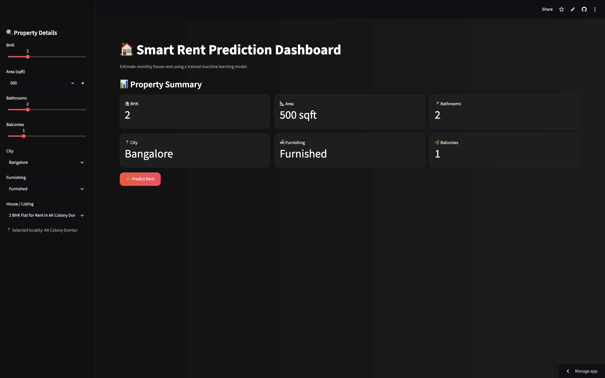
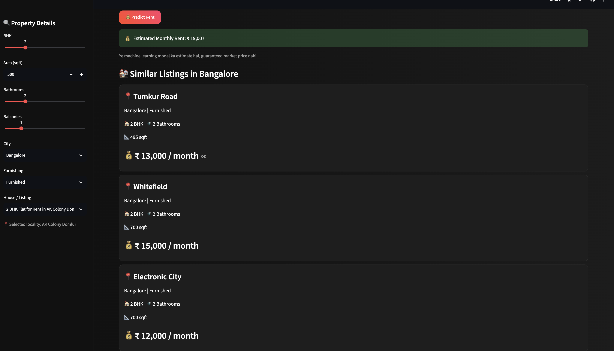

# 🏠 Smart Rent Prediction

### Machine Learning–Powered House Rent Estimation

Smart Rent Prediction is a machine learning web application that estimates monthly house rent based on property details. It uses a trained **XGBoost regression model** and helps users compare the estimated rent with similar property listings available in the dataset.

🚀 **Live Demo:** [Try Smart Rent Prediction](https://smart-rent-prediction-jpbmu7jrd7fhorqhrojsoi.streamlit.app/)

📂 **GitHub Repository:** [imhasim/smart-rent-prediction](https://github.com/imhasim/smart-rent-prediction)

## ✨ Features

- **Rent Prediction:** Estimate monthly house rent based on selected property details.
- **Property Details:** Select city, BHK, bathrooms, furnishing, area, and other available inputs.
- **Similar Property Listings:** Explore comparable properties based on selected property details.
- **Rent Comparison Chart:** Compare the model's estimated rent with rents recorded in similar listings.
- **Interactive Dashboard:** Use a Streamlit interface with a dark-themed design.
- **Data-Driven Estimates:** Generate predictions using a previously trained machine learning model.

## 🖥️ Live Application

Try the deployed application:

👉 [Open Smart Rent Prediction](https://smart-rent-prediction-jpbmu7jrd7fhorqhrojsoi.streamlit.app/)

## 📸 Screenshots

### Dashboard



### Rent Prediction and Similar Listings



## 🛠️ Tech Stack

| Technology | Purpose |
|---|---|
| Python | Application and ML logic |
| Streamlit | Interactive web application |
| XGBoost | Rent prediction model |
| Pandas | Dataset processing |
| NumPy | Numerical operations |
| Scikit-learn | Machine learning ecosystem |
| Joblib | Loading saved model artifacts |

## 🧠 How It Works

1. **User Input:** The user selects property details through the dashboard.
2. **Feature Preparation:** Input values are mapped to the features expected by the trained model.
3. **Model Prediction:** The saved XGBoost model estimates the monthly rent.
4. **Similar Listings:** The application filters property records and finds comparable listings.
5. **Visualization:** A chart compares the predicted rent with rents recorded in the selected listings.

## 📂 Project Structure

```text
smart-rent-prediction/
├── app.py
├── app.ipynb
├── requirements.txt
├── rent_model.pkl
├── rent_model_features.pkl
├── cities_magicbricks_rental_prices.csv
├── Makaan_data_700pages.csv
├── screenshots/
│   ├── dashboard.png
│   └── prediction.png
└── README.md
```

## 🚀 Run Locally

### 1. Clone the repository

```bash
git clone https://github.com/imhasim/smart-rent-prediction.git
```

### 2. Navigate to the project directory

```bash
cd smart-rent-prediction
```

### 3. Create and activate a virtual environment

```bash
python -m venv .venv
source .venv/bin/activate
```

### 4. Install dependencies

```bash
python -m pip install -r requirements.txt
```

### 5. Launch the application

```bash
streamlit run app.py
```

Streamlit will display a local URL in the terminal. Open that URL in your browser to use the application.

## 📊 Model and Data

- **Model:** XGBoost Regressor
- **Model artifact:** `rent_model.pkl`
- **Feature artifact:** `rent_model_features.pkl`
- **Property dataset:** `cities_magicbricks_rental_prices.csv`
- **Additional dataset:** `Makaan_data_700pages.csv`

The application loads the saved model and feature list to generate predictions. The property datasets support similar-listing comparisons and visualization.

## ⚠️ Important Disclaimer

Predicted rent values are estimates, not guaranteed market prices. Similar listings and comparison charts use the available dataset, which may contain historical rental values and may not reflect current market conditions.

## 🔮 Future Improvements

- Add more property locations and updated rental datasets.
- Improve model evaluation and document performance metrics.
- Add interactive filters and additional visualizations.
- Improve input validation and prediction reliability.

## 👨‍💻 Author

**Hasim Kureshi**

- GitHub: [@imhasim](https://github.com/imhasim)
- Project Repository: [Smart Rent Prediction](https://github.com/imhasim/smart-rent-prediction)

---

*Built with Python, Streamlit, and XGBoost.*
